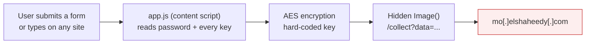

# FakeGPT: static analysis of a fake ChatGPT browser extension


A Chrome extension called **"ChatGPT"** (CyberDefenders FakeGPT lab) turned out to be a credential and keystroke stealer.
I analysed it without running it: hash, VirusTotal lookup, and reading the manifest and JavaScript.
The most interesting result is a negative one. **VirusTotal had no record of the file**, and the code was still clearly malicious.

> Part of the AstraQuantum Tech *Summer of Cybersecurity 2026* program, Week 9 (instructor: Husnain Shahid).

## At a glance

| | |
|---|---|
| Sample | `213-FakeGPT.zip`, 144,536 bytes, Manifest V2 extension named "ChatGPT" v1.0 |
| SHA256 | `84A4F75606314D3FD487CBA1B8F60353FC4F5A4851DC02B9DEEB2EC34250472D` |
| Verdict | Malicious, high confidence (based on the code, not on reputation) |
| VirusTotal | "Item not found" (hash never submitted) |
| Exfiltration | `mo[.]elshaheedy[.]com` through a hidden `Image()` request |

## How the stolen data leaves the browser



A standalone copy of the diagram is in [`docs/data-path.svg`](docs/data-path.svg).

## Findings

| ID | Finding | Confidence |
|---|---|---|
| MAL-01 | Manifest asks for all-site access, cookies, `webRequestBlocking`, persistent background script, while posing as an AI helper | Medium |
| MAL-02 | Code reads username/password on form submit and sends every `keydown` | High |
| MAL-03 | Data is AES-encrypted with a hard-coded key (`SuperSecretKey123`), which also lets defenders decrypt captured traffic | High |
| MAL-04 | Exfiltration through image requests to one external domain | High |
| MAL-05 | No VirusTotal record: not evidence either way | Low |
| MAL-06 | PEiD on a THM practice file shows no packer (signature-based, weak evidence) | Low to Medium |

## Repository layout

```
report/       final PDF report (6-8 page assignment format)
screenshots/  my own screenshots (TryHackMe, CyberDefenders, laptop)
iocs/         indicators as CSV (defanged)
detection/    small YARA rule built from strings seen in the code
docs/         diagram
```

## Detection

[`detection/fakegpt_extension.yar`](detection/fakegpt_extension.yar) matches two or more of the distinctive strings found in the extension code.
It is meant as a starting point for hunting extension folders, not as a production rule.

## Method and limits

- Tools: PowerShell `Get-FileHash`, VirusTotal (hash search only), Notepad, HxD, HashTab, PEiD.
- The package has no Windows executable, so PEStudio could not be used on it. PE observations come from HxD and PEiD on TryHackMe practice files.
- Only part of the JavaScript was read in detail; the lab description mentions anti-analysis techniques, so I do not claim the sample is free of obfuscation.

## Safety

No sample is stored here, only hashes, text indicators and screenshots. Nothing was executed and nothing was uploaded to VirusTotal.

## Author

**Muhammad Umer Imran** (AQT-1170)
